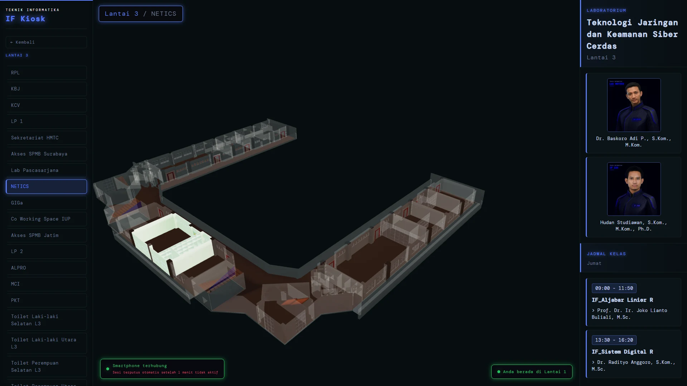
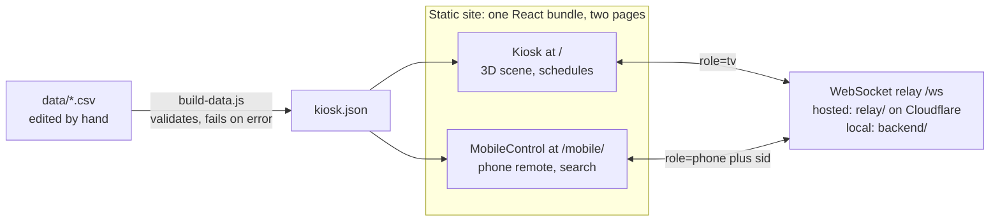
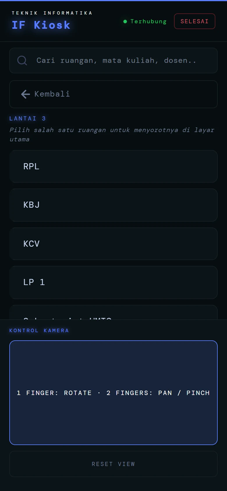
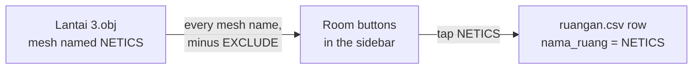

# IF E-Kiosk

An interactive 3D digital directory kiosk for the Informatics building (Teknik Informatika / TC), built for touchscreen displays. Visitors explore an interactive 3D model of the building floor by floor, look up rooms, lecturers, and class schedules, and can take over navigation from their own phone by scanning a QR code.



## Contents

- [Features](#features)
- [How it fits together](#how-it-fits-together)
- [Tech stack](#tech-stack)
- [Project structure](#project-structure)
- [Getting started](#getting-started)
- [Editing the data](#editing-the-data)
- [Environment variables](#environment-variables)
- [WebSocket protocol](#websocket-protocol)
- [Rooms and the 3D model](#rooms-and-the-3d-model)
- [Lecturer photos](#lecturer-photos)
- [Testing](#testing)
- [Deploying](#deploying)
- [Known limitations](#known-limitations)

## Features

- **Interactive 3D building model** — Three.js-rendered floors (`Lantai 1`–`4`) with animated transitions, room highlighting, and camera fly-to for selected rooms.
- **Room names on the map**: every room carries its name on the 3D model, sized to fit the room, so visitors can find a room by looking before they tap. See [Room labels](#room-labels).
- **Room directory** — search and browse rooms by floor, see whether a room is a classroom, lab or lecturer office.
- **Class schedules** — each classroom's schedule for today, from the semester timetable.
- **Lecturer directory** — search lecturers by name or by their code (e.g. `HF`) and jump straight to their office.
- **QR-code phone control** — scan a QR code on the kiosk to drive camera pan/zoom/rotate and navigation from your own phone over a WebSocket relay, without touching the kiosk screen.
- **No server, no database** — rooms, lecturers and schedules live in CSV files in `data/`. A build step validates them and turns them into one JSON file, and the whole kiosk is static files that GitHub Pages can host.

## How it fits together

The kiosk is a static site. Floor plans change rarely and the timetable once a semester, so the data is edited as CSV, checked and compiled at build time, and shipped with the site. The only moving part is the relay that pairs a phone with a kiosk, because two browsers cannot open a WebSocket to each other directly.



The kiosk opens a WebSocket as `role=tv`, receives a session id, and renders a QR code with a `/mobile/` URL carrying that id. When the phone scans it and connects as `role=phone`, the relay passes every message between the two sockets verbatim. Searching happens on the phone itself, against the same `kiosk.json`.



The phone gets search, the room list of whichever floor the kiosk shows, and a touch pad for the kiosk's camera. The room panel on the kiosk (the right-hand column in the screenshot above) only appears while a phone is paired. When pairing is off (`VITE_RELAY_URL=none`), it appears for rooms tapped on the kiosk screen instead.

<br clear="right">

**Touch gestures** are the same on the kiosk's screen and on the phone's touch pad. By default they work like a map app: one finger pans along the floor, two fingers rotate the view, and a pinch zooms. Opening the kiosk with `?gestures=orbit`, e.g. `https://hadziq.github.io/IF-Kiosk/?gestures=orbit`, switches both to the original scheme, with one finger to rotate and two to pan and pinch; the QR code passes the choice on to the phone. The two are kept side by side to be compared with visitors, and the one that loses will be removed (`GESTURES` in `frontend/src/lib/config.js`).

## Tech stack

| Layer     | Stack |
|-----------|-------|
| Frontend  | React 19, Vite, Three.js, `troika-three-text`, Tailwind CSS, `qrcode.react`, `lucide-react` |
| Data      | CSV files compiled to JSON at build time (`frontend/scripts/build-data.js`) |
| Relay     | A Cloudflare Worker with one Durable Object per session (`relay/`); Node.js `ws` locally (`backend/`) |
| Hosting   | GitHub Pages, deployed by GitHub Actions |
| Testing   | `node:test` (data build and search), Jest (relay protocol, run against both relays) |
| Tooling   | npm workspaces (single lockfile at the repo root) |

## Project structure

```
IF-Kiosk/
├── data/              The kiosk's content — edit these
│   ├── ruangan.csv        Rooms, one per mesh in the floor models
│   ├── dosen.csv          Lecturers: code and full name
│   ├── penghuni.csv       Which lecturers sit in which room, in display order
│   └── jadwal.csv         The semester's class schedule
├── frontend/          React + Vite kiosk UI
│   ├── scripts/
│   │   └── build-data.js  data/*.csv → public/data/kiosk.json, with validation
│   ├── src/
│   │   ├── main.jsx       Entry point: picks a page from the URL path
│   │   ├── pages/         Kiosk (/) and MobileControl (/mobile/)
│   │   ├── components/    Sidebar, SchedulePanel, QROverlay
│   │   ├── hooks/         Three.js scene, animations, model loading, WebSocket
│   │   └── lib/           Constants, deployment config, data loading, room lookup and search
│   ├── tests/         Tests for the data build and for search
│   └── public/
│       ├── models/    3D building/floor models (.obj/.mtl)
│       └── picture/   Lecturer photos, named by lecturer code (WebP)
├── backend/           Local WebSocket relay, and a static server for a LAN kiosk
│   ├── index.js       Entry point: HTTP server + WebSocket, exported for tests
│   ├── app.js         Serves frontend/dist
│   ├── ws/            The relay that pairs a kiosk screen with a phone
│   ├── utils/         LAN IP detection
│   └── tests/         The relay protocol tests, shared with relay/
├── relay/             Hosted WebSocket relay: Cloudflare Worker + Durable Object
│   ├── src/index.js   The Worker and the Session Durable Object
│   ├── wrangler.toml  Worker name, allowed origins, Durable Object binding
│   └── scripts/       Runs the protocol tests against the Worker in wrangler dev
├── .github/workflows/ Publish the site to GitHub Pages, deploy the relay to Cloudflare
└── docs/screenshots/  Images used in this README
```

## Getting started

### Prerequisites

- Node.js 18+

That is all. There is no database to set up.

### 1. Install dependencies

```bash
npm install
```

One command from the repo root installs everything. `backend` and `frontend` are npm workspaces sharing a single `package-lock.json`; do not run `npm install` inside those folders.

### 2. Run in development

```bash
npm run dev
```

This builds the data, then starts the local relay on `:8000` and the Vite dev server on `:5173` together.

- Kiosk UI: http://localhost:5173
- Phone page: scan the QR code; phone and computer must share a WiFi network

Vite proxies `/ws` to the relay, so the browser only ever talks to `:5173`. The QR code points at this machine's LAN address rather than `localhost`, which the phone could not reach.

The data is built once when `dev` starts. After editing a CSV, run `npm run data:check` to validate it, or restart `npm run dev` to see the change.

### 3. Build

```bash
npm run build     # validates data/, builds the frontend into frontend/dist
npm start         # optional: serves frontend/dist and the relay on :8000
```

`npm start` is for a kiosk on a LAN without internet. For the public site, see [Deploying](#deploying).

## Editing the data

All content is in four CSV files in `data/`. Edit them in Excel, LibreOffice or a text editor. Both `,` and `;` work as the separator, so a file saved by Excel with Indonesian regional settings is fine.

| File | Columns | Notes |
|---|---|---|
| `ruangan.csv` | `nama_ruang`, `lantai`, `kelas`, `lab`, `ruang_dosen`, `ruangan`, `keterangan`, `label_peta` | `nama_ruang` must equal the mesh name in the floor model; see [Rooms and the 3D model](#rooms-and-the-3d-model). The four flags take `1` for yes and empty for no. `label_peta` is the name drawn on the 3D model; see [Room labels](#room-labels). |
| `dosen.csv` | `kode`, `nama` | `kode` is the lecturer's code from the timetable (`HF`, `RJ`, …). Every other file refers to lecturers by code. |
| `penghuni.csv` | `nama_ruang`, `kode_dosen` | One row per lecturer per office. Rows for a room appear on the kiosk in file order. |
| `jadwal.csv` | `hari`, `jam_mulai`, `jam_selesai`, `nama_ruang`, `mata_kuliah`, `dosen_1`, `dosen_2`, `dosen_3` | `hari` is `Senin`…`Jumat`; times are `HH:MM`; `dosen_2` and `dosen_3` may be empty. |

Every cross-reference is checked when the data is built, and a broken one stops the build with the file and line to fix:

```
$ npm run data:check
GALAT       jadwal.csv:41: kode dosen "HFF" tidak ada di dosen.csv
GALAT       ruangan.csv:12: tidak ada mesh bernama IF_1O5 di model Lantai 1.obj; nama_ruang harus sama persis dengan nama mesh
```

Problems that do not break the kiosk are printed as `peringatan` (warnings) and the build continues: a lecturer without a photo, a mesh without a row in `ruangan.csv`, two classes overlapping in the same room, or one lecturer teaching in two rooms at overlapping times.

**Replacing the timetable each semester** means replacing the rows of `jadwal.csv`. Add any new lecturers to `dosen.csv` first.

**Publishing a change** is a commit to `master`. GitHub Actions validates the data, builds the site and publishes it. A kiosk that is already running checks for a new version every 10 minutes and reloads itself when no phone is connected.

## Environment variables

The deployed site needs none; see [Deploying](#deploying) for its build settings.

The local relay in `backend/` reads these from `backend/.env`. Both are optional.

| Variable | Default | Purpose |
|---|---|---|
| `PORT` | `8000` | Port the relay and static server listen on. |
| `PUBLIC_FRONTEND_URL` | auto-detected LAN IP | Origin to put in the QR code instead of the kiosk's own. Set this when the phone must reach the kiosk some other way, e.g. through a tunnel. |

The frontend build reads two variables:

| Variable | Default | Purpose |
|---|---|---|
| `BASE_PATH` | `/` | Path the site is served from. The Pages workflow sets `/IF-Kiosk/`. |
| `VITE_RELAY_URL` | same origin | Relay to connect to, without `/ws`, e.g. `wss://if-kiosk-relay.<account>.workers.dev`. Unset means the page's own origin (the local relay). `none` turns phone pairing off: the kiosk works but shows no QR code. |

When the kiosk is opened as `localhost`, the local relay reports the machine's LAN address and the kiosk uses it in the QR code, preferring a real private address over the `.1` / `.254` gateways that Docker and VMware adapters hand out (`backend/utils/network.js`).


## WebSocket protocol

One endpoint, `/ws`, with the role chosen by query string.

| Connect as | Query | Meaning |
|---|---|---|
| Kiosk | `/ws?role=tv` | Opens a new session. |
| Phone | `/ws?role=phone&sid=<id>` | Joins an existing session. |

Anything else is closed with code **1008**. So is a phone presenting an unknown `sid`. A second phone joining a session that already has one is closed with **1000** and the reason `session already in use` — one phone per kiosk at a time.

**Messages from the relay:**

| Type | Sent to | Meaning |
|---|---|---|
| `session` | kiosk | `{ type, sid }` — issued immediately on connect. The kiosk builds the QR code URL itself, `<origin><base>mobile/?sid=<sid>`. The local relay adds `lanAddress` (or `mobileOrigin` when `PUBLIC_FRONTEND_URL` is set) so a kiosk opened as `localhost` can use an address the phone can reach. |
| `phoneConnected` | kiosk | A phone has paired; the kiosk responds by pushing its current state. |
| `phoneDisconnected` | kiosk | The phone went away, or timed out. |

**Messages relayed between the pair:**

| Type | Direction | Shape |
|---|---|---|
| `cmd` | phone → kiosk | `{ type: "cmd", action, payload }` where `action` is one of `selectFloor`, `selectRoom`, `selectFloorAndRoom`, `back`, `cameraRotate`, `cameraZoom`, `cameraPan`, `cameraTransform`, `cameraReset`. |
| `state` | kiosk → phone | Current floor, selected room and camera state, so the phone UI can mirror the screen. |

A phone that sends nothing for **one minute** is disconnected with **1000** `idle` (`PHONE_IDLE_MS`), which frees the session for the next visitor. When the kiosk disconnects, its phone is closed with **1000** `session ended`, and the session id stops working.

The kiosk sends the plain text `ping` every 30 seconds and the relay answers `pong`, so a kiosk waiting hours for a phone is not dropped as idle. On Cloudflare the answer comes from the runtime without waking the Durable Object, so an idle kiosk costs nothing.

Both relays implement this protocol: `backend/ws/` locally and `relay/` on Cloudflare. `backend/tests/relay.test.js` is its specification. It runs against the local relay by default, and `npm --prefix relay test` runs the same file against the Worker in `wrangler dev`.

## Rooms and the 3D model

The room list on the kiosk does not come from the data. It comes from the **mesh names inside the 3D model**, and the data is then asked about each name. So a room shows up in two places that must agree:



### The model files

Each floor is a Wavefront pair in `frontend/public/models/`, loaded by name from the `FLOORS` list in `frontend/src/lib/constants.js`:

| File | Shown when |
|---|---|
| `TC.obj` + `TC.mtl` | The whole-building overview, before a floor is chosen. |
| `Lantai 1.obj` … `Lantai 4.obj` (+ `.mtl`) | A floor is selected. The file name is the floor name, space included. |

When a floor loads, `useModelLoader` collects every named mesh. `Sidebar` then drops any name matching `EXCLUDE` (`pillar`, `box`, `TV`, `lantai`, `tangga`, `pintu`, `sebelah`, case-insensitive), and every remaining name becomes a room button. Tapping one highlights that mesh and looks the name up in `kiosk.json`.

### The rules that tie a mesh to a row in `ruangan.csv`

- **`nama_ruang` must equal the mesh name.** The match is case-sensitive: a mesh called `NETICS` will not find a row called `Netics`. The data build checks every row against its floor's `.obj` and stops if the mesh is missing.
- **Spaces and underscores are interchangeable.** OBJ exporters turn spaces into underscores, so `Aula_Handayani` matches a row named `Aula Handayani`. Buttons display underscores as spaces.
- **`lantai` must be the floor's file name**, e.g. `Lantai 3`. Search results use it to decide which model to load before jumping to the room.
- **A mesh with no matching row is a warning, not an error.** The panel shows the room name and nothing else. The only such meshes today are the two small `Akses_SPMB_*` markers on Lantai 3, which are not rooms, and `SPMB_Jatim` and `SPMB_Surabaya` on Lantai 4.
- **Mesh names must be unique across floors**, because `nama_ruang` is unique. Rooms that repeat on every floor carry a floor suffix. The toilets follow `Toilet_<Laki-laki|Perempuan>_<Utara|Selatan>_L<floor>`, e.g. `Toilet_Perempuan_Selatan_L2`. The names currently in the models, `Toilet_<Mahasiswa|Mahasiswi>_L<floor><U|S>` and `Toilet_Pegawai_<Laki-laki|Perempuan>_<Utara|Selatan>`, are recognised too and get the same pictograms. In the models, north (*Utara*) is the side with the IF_101 / IF_201 / RPL row, and south (*Selatan*) is the side with IF_110 / IF_222 / LP_2.
- **`TC.obj` names are never looked up.** The overview model has its own, older labels (`Toilet_Cewe_A`, `IF_114`, …). Only the four floor models need to agree with `ruangan.csv`.

What the panel shows is driven by the flags on the row, and they combine freely. `LP_2`, for example, is a lab and a classroom and a lecturer office at once:

| Flag | Effect on the kiosk panel |
|---|---|
| `lab` | Header reads *Laboratorium*. |
| `ruang_dosen` | Header reads *Ruang Dosen*; lists lecturers from `penghuni.csv`. |
| `kelas` | Shows today's classes from `jadwal.csv`. |
| `ruangan` | A labelled space. With none of the three flags above, the panel shows only the name and `keterangan`. |

### Adding a room

1. **Name the mesh** in your 3D tool, then export that floor over the existing `Lantai N.obj` and `.mtl`. Choose the name carefully, because it becomes the room's permanent key.
2. **Add the row to `data/ruangan.csv`.** Copy the mesh name exactly, and set `lantai` and the flags.
3. **Attach what the flags promise:** rows in `penghuni.csv` for `ruang_dosen`, rows in `jadwal.csv` for `kelas`. A lecturer's photo follows the rules in [Lecturer photos](#lecturer-photos).
4. **Run `npm run data:check`**, then check it on the kiosk: open the floor, tap the room and confirm the panel is filled, not just the bare name.

Adding a whole floor also means adding its name to `FLOORS` in `frontend/src/lib/constants.js`. If its rooms need a particular order in the sidebar, add a sort to `getRoomSort` in the same file, like the one for `Lantai 3`.

### Room labels

Every row of `ruangan.csv` puts a label on its room in the floor model, so a visitor can find a room by looking at the map before tapping anything.
Rooms in the model without a row (the `Akses_SPMB_*` markers, `SPMB_*` on Lantai 4) get no label, and the whole-building overview has none.

| `label_peta` | Label on the model |
|---|---|
| empty | `nama_ruang` with underscores as spaces, e.g. `IF 218`, `Aula Handayani` |
| any text | That text, e.g. `Mushola` for `IF_202` |
| `-` | No label |

- **Labels fit their room.** Each label is sized in metres to fit inside its room, so labels never overlap, and it always faces the screen, so it reads upright however the model is turned.
  Classrooms and labs get the largest text; the 4 m lecturer offices on Lantai 2 get about half.
- **Small labels appear as you zoom in.** A label too small on screen to read fades out and fades back in as the visitor zooms toward it, the way map apps hide street names when zoomed out.
- **Long names wrap at spaces**, but a word of one or two letters or a number stays with its neighbour: `Ruang Sidang` may wrap, `IF 218` and `LP 1` never break.
  Keep labels short anyway; a long label in a small room is drawn small and only shows when zoomed in.
- **A selected room's label turns green** and stays readable, while the other labels dim with their rooms.
- **Toilets share a sign.** The men's and women's toilets on one side of a floor stand next to each other, so they get one restroom pictogram instead of two text labels. This relies on the toilet naming rule above. Giving a toilet a `label_peta` replaces its pictogram with that text.

Labels are drawn by `frontend/src/lib/roomLabels.js`; which rooms get which label is decided by `getMapLabels` in `frontend/src/lib/directory.js`.
`label_peta` is also searchable from the phone, so a room labelled `Mushola` is found by searching for it.

## Lecturer photos

Photos live in `frontend/public/picture/` and are named by **lecturer code**: the lecturer with `kode` `HF` in `dosen.csv` has the photo `HF.webp`.

- **Adding a lecturer photo:** save it as WebP, 1024×1024, named `<kode>.webp`.
- **A missing photo is not an error.** The panel renders the lecturer's initials instead, and the data build lists every lecturer still without a photo as a warning.

These were originally 1024×1024 PNGs averaging 1.1 MB each — 56 MB for 50 portraits. They are now WebP at the same resolution, 2 MB in total, which is visually indistinguishable at the 150px the UI actually renders.

## Testing

```bash
npm test
```

This runs every suite. None needs a database, a Cloudflare account or a network.

- `frontend/tests/` (`node:test`): the CSV parser, every validation rule of the data build, a check that the real `data/*.csv` builds cleanly against the real models, and room lookup and search.
- `backend/tests/relay.test.js` (Jest): the relay protocol — pairing, relaying, ping, the 1008 rejections, the one-phone-per-session limit, and ending a session. It runs twice: against the local relay, and against the Cloudflare Worker running locally in `wrangler dev`.

GitHub Actions runs the same command on every push and pull request.

## Deploying

### GitHub Pages (the public site)

`.github/workflows/pages.yml` tests and builds every push, and publishes pushes to `master` at https://hadziq.github.io/IF-Kiosk/. One-time setup in the repository settings:

1. **Pages → Build and deployment → Source:** GitHub Actions.
2. **Nothing else is required.** The site is built to use the relay at `wss://if-kiosk-relay.labgigaits.workers.dev`. To use another relay, set the repository variable `RELAY_URL` (**Secrets and variables → Actions → Variables**); set it to `none` to turn phone pairing off. A page served over `https` cannot open an unencrypted `ws://` connection to a LAN relay, so the hosted site needs a `wss://` relay.

Point the kiosk browser at the site in fullscreen/kiosk mode.

### The relay on Cloudflare

`.github/workflows/relay.yml` tests `relay/` and deploys it with `wrangler deploy` whenever it changes on `master`, or when run by hand from the Actions tab. One-time setup:

1. In the Cloudflare dashboard of the lab GIGA account, open **Workers & Pages**. Its `workers.dev` subdomain is `labgigaits`; note the **Account ID** shown there.
2. Under **My Profile → API Tokens**, create a token from the **Edit Cloudflare Workers** template, limited to the lab account.
3. In the repository, add the secrets `CLOUDFLARE_API_TOKEN` and `CLOUDFLARE_ACCOUNT_ID` (**Settings → Secrets and variables → Actions**).
4. Run the **Relay** workflow. The relay is then live at `https://if-kiosk-relay.labgigaits.workers.dev`.

If the relay ever moves to another account or subdomain, set `RELAY_URL` to its new `wss://` address and re-run the **Pages** workflow.

`ALLOWED_ORIGINS` in `relay/wrangler.toml` lists the sites whose pages may connect; add an origin there if the kiosk is ever served from somewhere else.

The free Workers plan covers a kiosk comfortably. Durable Objects bill a WebSocket message as 1/20 of a request, and the kiosk's pings are answered without one, so only a visitor actively using their phone counts against the 100,000 requests a day.

### On a LAN, without internet

1. `npm run build`, then `npm start`. The backend serves the built frontend and the relay from a single port.
2. Point the kiosk browser at `http://localhost:8000` in fullscreen/kiosk mode. The QR code uses the machine's LAN address automatically.
3. Phones must be on the same network. If they are not, set `PUBLIC_FRONTEND_URL` to an address they can reach.

## Known limitations

- **Phone pairing on the public site depends on the relay.** If it cannot be reached when the kiosk loads, no QR code appears; the kiosk retries every few seconds, and the touchscreen keeps working.
- **The relay's origin check is not authentication.** It stops other websites from using the relay from a browser; a non-browser client can still connect. A session can only be joined with its random session id, which only the kiosk's QR code shows.
- **Sessions on the local relay are held in memory.** Restarting it drops every active pairing.
- **The frontend ships as one bundle** of roughly 850 KB (230 KB gzipped), dominated by Three.js. Fine for a kiosk on a wired connection; worth code-splitting if the phone page is often loaded over mobile data.
- **`lint` reports pre-existing warnings** about refs being accessed during render in `useWebSocket.js` and elsewhere. They are long-standing and unrelated to the current structure.
